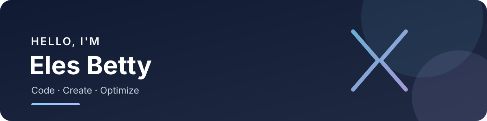

  

<h1 align="center">Hai, saya Eles Betty 👋</h1>

  Pengembang otodidak dan kreator dari Indonesia. 
  Mengeksplorasi pengembangan web, seluler, dan gim — satu proyek kecil dalam satu waktu.

  
  

## Tentang saya

Saya kembali ke dunia pengembangan perangkat lunak setelah jeda cukup panjang, membangun kembali fondasi saya dan menemukan cara belajar yang berkelanjutan. Saya tertarik pada proyek yang menggabungkan kode dengan kreativitas: mulai dari aplikasi web dan seluler hingga gim, visual, animasi, musik, serta efek suara.

Saya pernah membuat satu gim *platformer* secara utuh menggunakan **ActionScript**, merancang sendiri mekanik, aset 3D, seni 2D, musik, hingga efek suaranya. Pengalaman tersebut masih membentuk apa yang ingin saya ciptakan hingga saat ini: proyek-proyek kecil yang dipikirkan dengan matang, bekerja dalam batasan dunia nyata, dan menyenangkan untuk dieksplorasi.

## Teknologi & alat yang sedang saya pelajari

Ini adalah minat dan target belajar saya, bukan klaim atas pengalaman profesional.

 

 

 

**Juga penasaran dengan:** Unity · Affinity · Model AI Lokal · Aplikasi Sumber Terbuka / Gratis Lainnya

## Cara saya dalam berkarya

- Memulai dari cakupan yang tepat. Saya ingin membuat proyek-proyek kecil yang dapat diselesaikan, dipahami, dan ditingkatkan.
- Membangun untuk perangkat nyata. Saya sering menggunakan ponsel, tablet, dan laptop, serta tertarik pada alur kerja yang mempertimbangkan berbagai perangkat keras dan konfigurasi.
- Memaksimalkan sumber daya yang terbatas. Perangkat lunak yang ringan dan perangkat keras berspesifikasi rendah bukan sekadar batasan bagi saya; itu adalah tantangan desain yang menyenangkan untuk dipelajari.
- Menjaga keterlibatan aspek kreatif. Kode, visual, animasi, musik, dan suara semuanya dapat berkontribusi pada hasil akhir suatu karya.
- Mendokumentasikan proses belajar. Ketika saya mulai memublikasikan proyek, saya ingin repositori tersebut menjelaskan keputusan dan proses pembuatan, bukan sekadar berisi berkas akhir saja.

Saat ini saya sedang membangun kembali keterampilan saya di bidang pengembangan web, seluler, dan gim. Seiring diselesaikannya proyek-proyek baru, saya akan membagikan kode beserta proses pembuatannya di sini.

Belajar sambil berkarya — dan menemukan cara yang cermat untuk memaksimalkan hal terbatas.
