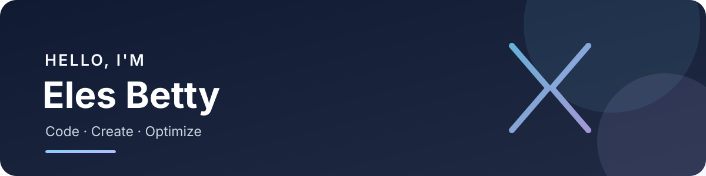

  

<h1 align="center">Hi, I'm Eles Betty 👋</h1>

  Self-taught developer and creative maker from Indonesia. 
  Exploring web, mobile, and game development — one small project at a time.

  
  

## About me

I’m returning to software development after a long break, rebuilding my foundations and finding a sustainable way to learn. I’m drawn to projects that combine code with creativity: from web and mobile apps to games, visuals, animation, music, and sound.

I once made a complete platformer game in **ActionScript**, creating its mechanics, 3D assets, 2D art, music, and sound effects along the way. That experience still shapes what I want to make: small, thoughtful projects that work within real-world limits and are fun to explore.

## Technologies & tools I'm exploring

These are interests and learning goals, not a claim of professional experience.

 

**Also curious about:** Unity · Affinity · GarageBand · Local AI Models · Other Open Source - Free Apps

## How I like to build

- Start with a useful scope. I want to make small projects that can be completed, understood, and improved.
- Build for real devices. I often use a phone, tablet, and laptop, and I’m interested in workflows that account for different hardware and configurations.
- Make limited resources go further. Lightweight tools and low-end hardware are not just constraints for me; they’re a design problem I enjoy learning about.
- Keep the creative parts close. Code, visuals, animation, music, and sound can all contribute to a finished experience.
- Document the learning. When I start publishing projects, I want the repositories to explain the decisions and process, not just contain the final files.

I’m currently rebuilding my skills across web, mobile, and game development. As I finish new projects, I’ll share the code and the process here.

Learning by making — and finding thoughtful ways to do more with less.

